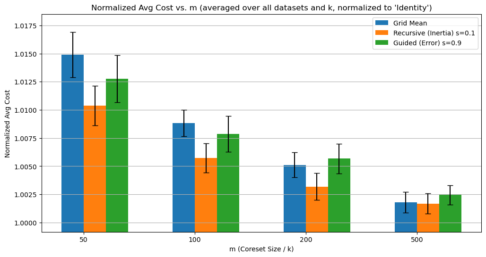
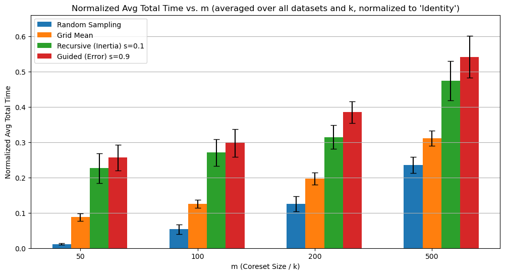

# Accelerating K-Means with Grid-Based Coresets

My MEng Computer Science final year project at UCL (2025), supervised by Dr. Ran Ben Basat.

This project looks at whether **partitioning space into grids** is a good way to build **coresets** for k-means clustering on large, low-dimensional datasets. A coreset is a small, weighted summary of the data. Running k-means on it should give centres almost as good as running on the full dataset, in a fraction of the time.

📄 **[Read the full report (PDF)](docs/FYP_report.pdf)**

## The Methods

All three methods split the space into cells and replace every non-empty cell with **one point at the mean of the points in that cell**, weighted by how many points the cell holds. Each method's target coreset size is `m × k`.

| Method | Idea |
|---|---|
| **Grid Mean** | A static, uniform grid. A binary search finds the cell width that gives the target number of non-empty cells. Simple and fast, but it treats dense and sparse regions the same. |
| **Recursive Grid** | Starts from a coarse grid and keeps splitting the highest-scoring cell into 2<sup>d</sup> sub-cells until it reaches the target size. Detail goes where the data is complex. Score heuristics: population, variance, inertia, diameter, MAD. |
| **Guided Grid** | Extends Recursive Grid by re-running k-means on the current coreset every so often. It then scores cells by how they relate to the current centres. Score heuristics: error, impurity, label entropy, margin. |

They are compared against **Random Sampling** and **Identity**, which is plain k-means on the full dataset with 10 k-means++ restarts.

## Results

The methods were tested on synthetic **Blobs** (1M points) and two real datasets, **Covertype** (581K) and **US Census 1990** (2.4M), each reduced to 2D and 3D with PCA. Runs covered k ∈ {10…50} and m ∈ {50, 100, 200, 500}, with 10 seeds per configuration. Every value is normalised to the Identity baseline: a cost of 1.0 means the same clustering cost as full k-means.

<p align="center">
  
  
</p>

- **Recursive Grid gives the best accuracy.** At m = 100 it comes within ~0.6% of full k-means cost in roughly a quarter of the time.
- **Grid Mean is the fastest grid method.** At large coresets its accuracy nearly matches Recursive Grid.
- **Guided Grid fell short of expectations.** It was usually more accurate than Grid Mean at small coresets, but the repeated k-means runs made it the slowest method.
- **Random Sampling is very fast but inaccurate.** It was more than 20% worse than full k-means at m = 50.

See the report for the full analysis, including the per-dataset breakdowns, the parameter studies and the limitations.

## Repository Structure

```
├── src/
│   ├── coresets/
│   │   ├── grid/          # Grid Mean, Recursive Grid, Guided Grid, score heuristics, grid size search
│   │   └── standard/      # Identity and Random Sampling baselines
│   └── benchmarking/      # dataset loading, experiment constants, test framework
├── experiments/
│   ├── sanity_checks/     # checks that each method behaves as designed
│   ├── preliminary_tests/ # parameter studies used to pick the final configurations
│   └── full_tests/        # the experiments analysed in the report
├── analysis/              # plotting and results-table scripts
├── results/               # CSV results from the preliminary and full tests
├── plots/                 # every generated figure (the `final*` folders hold the headline comparisons)
├── docs/                  # the project report
└── run_all.py             # runs the whole pipeline
```

## Getting Started

```bash
conda create -n grid-coreset python=3.12 -y
conda activate grid-coreset
pip install -r requirements.txt
pip install -e .
```

The real-world datasets are downloaded from the UCI repository the first time they are needed, then cached in `data/`.

## Running the Experiments

`run_all.py` runs the pipeline end to end, or any subset of its stages:

```bash
python run_all.py                    # full tests + plots (reproduces the report figures)
python run_all.py plots              # regenerate all plots from the saved results (~30s)
python run_all.py full --parallel    # run the three full-test scripts at the same time
python run_all.py all                # sanity checks, preliminary tests, full tests, plots, tables
python run_all.py all --dry-run      # list what would run
```

| Stage | Runs | Output |
|---|---|---|
| `sanity` | `experiments/sanity_checks/` | `sanity_check_results/` |
| `preliminary` | `experiments/preliminary_tests/` | `results/` |
| `full` | `experiments/full_tests/` | `results/` |
| `plots` | `analysis/plot_main.py` | `plots/` |
| `tables` | `analysis/print_results.py` | `results_display/` |

> ⚠️ The experiments are slow. On an M3 MacBook Pro the full tests took about a day, and most of that was the Guided Grid tests. The results are already in `results/`, so you can regenerate every plot without re-running anything.

Each script can also be run on its own from the repository root:

```bash
python experiments/sanity_checks/test_grid_mean.py
```
